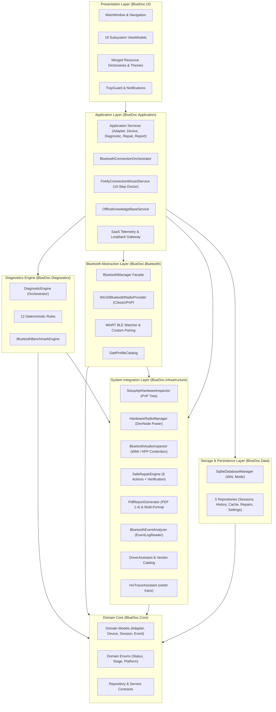
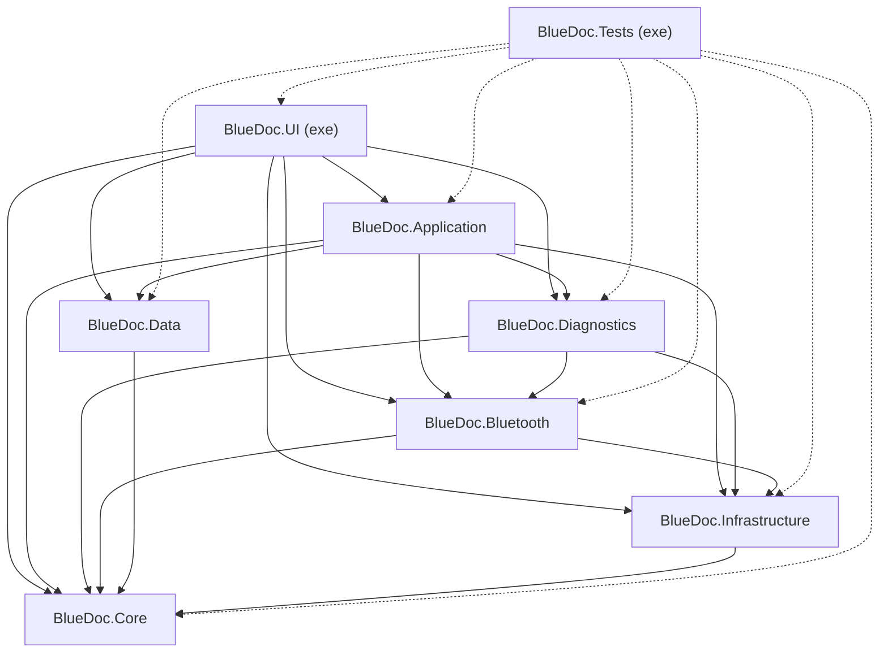
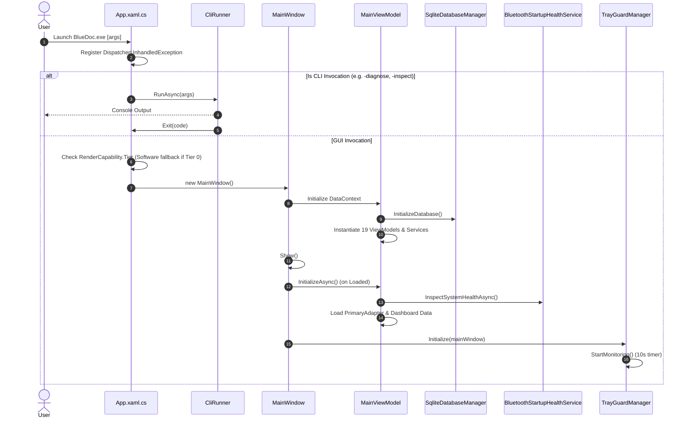
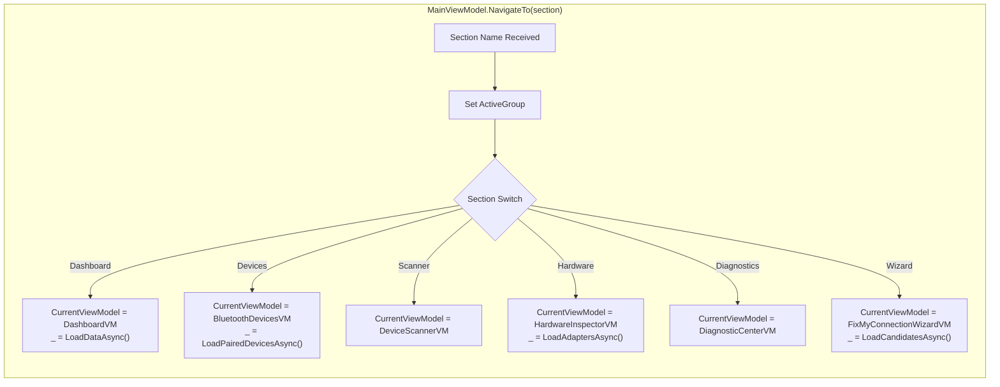
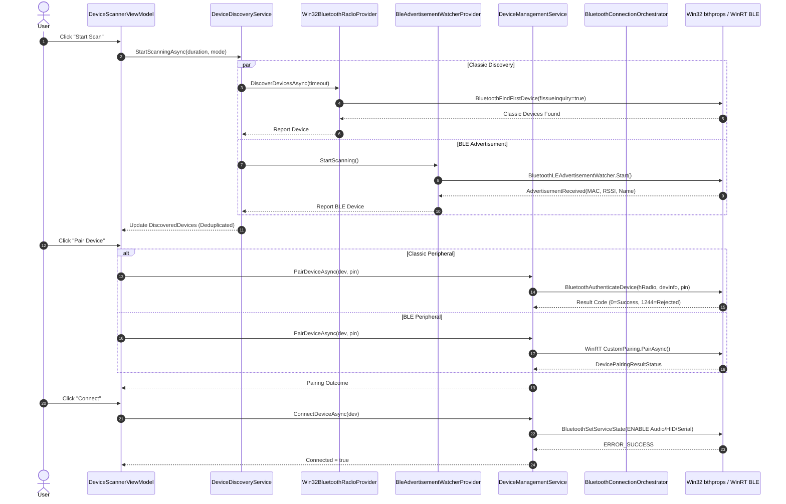
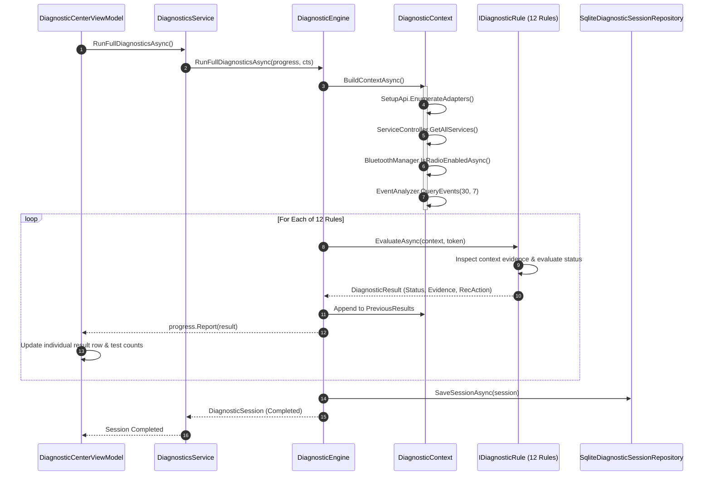
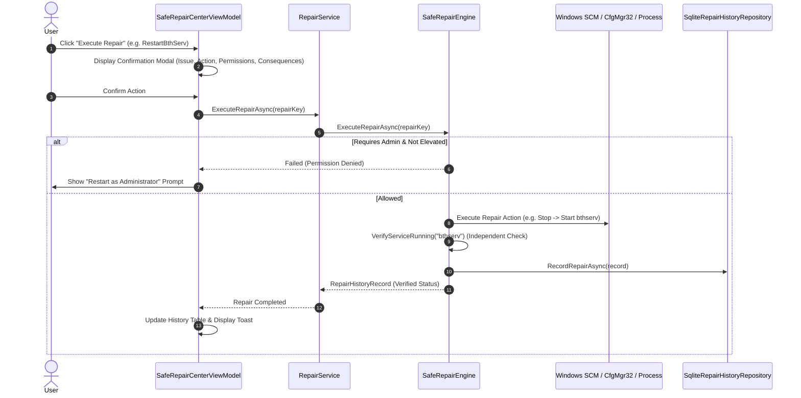
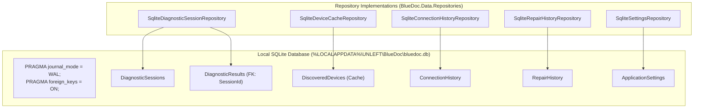

# 03. Architecture & Dependency Audit — BlueDoc

**Product:** BlueDoc  
**Company:** UNLEFT LLC  
**Lead Developer:** Golam Morshed Eashan  
**Audit Date:** November 14, 2026  
**Auditor:** Senior Forensic Audit Consortium  

---

## 1. High-Level Architecture Overview

BlueDoc follows a modular 6-tier architecture designed to decouple the presentation layer from the underlying operating system and hardware APIs.



---

## 2. Project Dependency Graph & Assembly Analysis



### Dependency Findings & Clean Architecture Adherence
1. **Strict Core Layer Isolation:** `BlueDoc.Core` has ZERO project references and depends only on system core libraries. No circular dependencies exist.
2. **Layer Inversion Violation in UI:** `BlueDoc.UI` directly references all projects including `BlueDoc.Infrastructure` and `BlueDoc.Bluetooth`. While common in traditional WPF applications, it bypasses the application layer facade.
3. **WinRT Dependency Coupling:** `BlueDoc.Bluetooth` directly references `Windows.winmd` from Windows Kits 10, creating a binary hazard on Windows 7 SP1.

---

## 3. Application Startup Sequence



---

## 4. Navigation Architecture & ViewModel Lifecycles

### 4.1 Navigation Pattern
BlueDoc uses ViewModel-based navigation. `MainWindow.xaml` binds its center `ContentControl` to `MainViewModel.CurrentViewModel`. `DataTemplates` map each ViewModel type to its corresponding `UserControl` view:

```xml
<DataTemplate DataType="{x:Type vm:DashboardViewModel}">
    <views:DashboardView />
</DataTemplate>
```

### 4.2 ViewModel Lifetime & Memory Management
- **All 19 ViewModels are eagerly instantiated** in `MainViewModel` constructor.
- ViewModels are kept in memory for the lifetime of the application.
- **Benefits:** Instant page transitions (zero XAML recompilation or instantiation lag); state preservation across section switches.
- **Drawbacks:** Memory consumption is higher upfront (~60 MB working set); initial startup performs multiple service initializations.



---

## 5. Bluetooth Operation Flow (Discovery, Pairing, Connection)



---

## 6. Diagnostic Execution Flow



---

## 7. Safe Repair Execution Flow



---

## 8. Data Architecture & Storage Flow



---

## 9. Architectural Risks & Code Smells

| Finding ID | Component | Architectural Risk / Code Smell | Severity | Recommendation |
|---|---|---|---|---|
| **BD-CRIT-002** | `BlueDoc.Bluetooth` | Direct compilation reference to `Windows.winmd` without dynamic isolation. | Critical | Separate WinRT BLE code into a standalone satellite assembly or use dynamic WinRT activation to ensure Windows 7 SP1 runtime safety. |
| **BD-MED-001** | `MainViewModel` | Tight coupling with concrete `new` instantiations for all 19 ViewModels. | Medium | Introduce an `IServiceProvider` / DI container (e.g., `Microsoft.Extensions.DependencyInjection`). |
| **BD-LOW-002** | `MainViewModel` | Fire-and-forget `_ = Task` invocations in navigation switch. | Low | Wrap navigation data loading tasks in safe error-capturing handlers. |
| **BD-MED-003** | `TrayGuardManager` | Continuous SetupAPI device enumeration polling every 10 seconds. | Medium | Replace timer polling with Win32 `RegisterDeviceNotification` (`WM_DEVICECHANGE`). |

