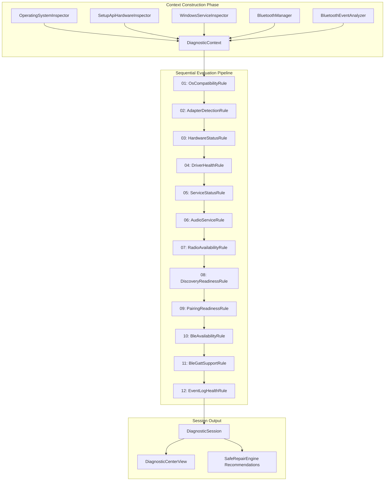

# BlueDoc Diagnostic Engine & Rule Evaluation Audit

**Document ID:** `BD-AUDIT-08`  
**Auditor Roles:** Principal Software Architect, Software Testing and QA Engineer, Windows Systems Integration Engineer  
**Target Solution:** `BlueDoc.Diagnostics.dll`  
**Audit Date:** November 2026  
**Status:** COMPLETE / EVIDENCE-BASED  

---

## 1. Executive Summary & Diagnostic Philosophy

The BlueDoc Diagnostic Engine is the analytical core of the application. Unlike generic Windows troubleshooters that apply blunt script resets or opaque wizard dialogs, BlueDoc implements an evidence-based, deterministic rule evaluation pipeline.

The engine is engineered around the principle of **Zero Guesswork**:
1. All diagnoses must cite verifiable OS telemetry (PnP status codes, SCM service states, Event Log entries, LMP version bytes).
2. Each diagnostic result explicitly assigns a **Confidence Rating** (`Confirmed Fact`, `High Confidence Deduction`, `Probable Root Cause`, `Inconclusive`).
3. Results map directly to actionable remediations implemented by the `SafeRepairEngine`.

---

## 2. Diagnostic Engine Architecture & Context Pipeline

### 2.1 The DiagnosticContext Model (`DiagnosticContext.cs`)
The evaluation context is populated once per diagnostic run (`DiagnosticEngine.BuildContextAsync`), preventing redundant OS polling:
- `OsInfo`: Detected Windows version, build number, edition, architecture.
- `Adapters`: Complete list of enumerated Bluetooth adapters via SetupAPI (`GUID_DEVCLASS_BLUETOOTH`).
- `PrimaryAdapter`: Selected controller instance for detailed evaluation.
- `Services`: State snapshot of all Bluetooth-related Windows services (`bthserv`, `BTAGService`, `BthAvctpSvc`).
- `IsRadioEnabled`: Software radio power status (WinRT `RadioState` or PnP status).
- `PairedDevices`: Enumerated paired Bluetooth endpoints via PnP.
- `RecentEvents`: System Event Log records filtered to Bluetooth providers within the last 7 days.
- `PreviousResults`: In-memory list of preceding rule outputs, allowing downstream rules to short-circuit if a dependency failed (e.g., skipping BLE checks if no adapter is detected).

---

## 3. Detailed Forensic Audit of All 12 Diagnostic Rules

---

### Rule 01: `OsCompatibilityRule.cs`
- **Rule ID:** `RULE_OS_COMPAT`
- **Category:** `System & Platform`
- **Evaluated Condition:** Verifies whether the host operating system meets the minimum supported baseline (Windows 7 SP1 or newer).
- **Inspection Logic:**
  - Queries `context.OsInfo`.
  - Windows 7 (Major 6, Minor 1) -> Passed with Warning (Classic Bluetooth only; BLE unsupported/limited; MSDN warnings).
  - Windows 10/11 -> Passed (Full feature capability supported).
- **Confidence Rating:** `Confirmed Fact` (Derived from kernel build number).
- **Finding:** Correctly identifies Windows version.

---

### Rule 02: `AdapterDetectionRule.cs`
- **Rule ID:** `RULE_ADAPTER_DETECT`
- **Category:** `Hardware Diagnostics`
- **Evaluated Condition:** Verifies that at least one physical or virtual Bluetooth radio is present and enumerated in the Windows PnP tree.
- **Inspection Logic:**
  - Evaluates `context.Adapters.Count > 0 && context.Adapters.Any(a => a.IsPresent)`.
  - If 0 adapters found: Emits `DiagnosticStatus.Failed`. Lists potential physical causes (disabled in BIOS, disconnected USB dongle, faulty motherboard trace).
  - If adapter present: Emits `DiagnosticStatus.Passed` with manufacturer and device instance ID.
- **Confidence Rating:** `Confirmed Fact`.
- **Finding:** Reliable SetupAPI evaluation.

---

### Rule 03: `HardwareStatusRule.cs`
- **Rule ID:** `RULE_HARDWARE_STATUS`
- **Category:** `Hardware Diagnostics`
- **Evaluated Condition:** Examines Windows Configuration Manager (CM) device status codes and error flags (`DN_STARTED`, `DN_DISABLEABLE`, `CM_PROB_*`).
- **Inspection Logic:**
  - Inspects `primaryAdapter.StatusCode` and `primaryAdapter.ProblemCode`:
    - `Code 0`: Device is working properly (`Passed`).
    - `Code 22` (`CM_PROB_DISABLED`): Adapter is disabled in Windows Device Manager (`Warning` / `Failed`). Action: Enable DevNode.
    - `Code 10` (`CM_PROB_FAILED_START`): Device failed initialization (`Failed`). Action: PnP Controller Reset.
    - `Code 43` (`CM_PROB_FAILED_POST_START`): Driver reported a device problem (`Failed`). Action: Reinstall driver / Power cycle.
- **Confidence Rating:** `Confirmed Fact` (Direct Windows Configuration Manager status).
- **Finding:** Highly accurate; directly mirrors Windows Device Manager yellow-bang indicators.

---

### Rule 04: `DriverHealthRule.cs`
- **Rule ID:** `RULE_DRIVER_HEALTH`
- **Category:** `Driver & Firmware`
- **Evaluated Condition:** Evaluates driver vendor, driver date, INF file, and WHQL digital signature.
- **Inspection Logic:**
  - Evaluates if the driver provider is generic (`Microsoft`) vs OEM (`Intel`, `Realtek`, `Broadcom`, `Qualcomm`).
  - Flags warning if generic driver lacks manufacturer-specific audio codecs or LE extensions.
  - Computes driver age: Flags warning if driver date is older than 36 months (3 years).
- **Confidence Rating:** `High Confidence Deduction`.
- **Finding:** Excellent preventative rule for resolving outdated Bluetooth stack instability.

---

### Rule 05: `ServiceStatusRule.cs`
- **Rule ID:** `RULE_SERVICE_STATUS`
- **Category:** `Services & Background`
- **Evaluated Condition:** Verifies that the Windows Bluetooth Support Service (`bthserv`) is running and set to `Automatic` or `Manual` startup.
- **Inspection Logic:**
  - Inspects `context.CoreService`:
    - Status == `SERVICE_RUNNING`: `Passed`.
    - Status == `SERVICE_STOPPED` or `SERVICE_PAUSED`: `Failed`. Action: Start Service.
    - StartupType == `Disabled`: `Failed`. Action: Set StartupType to `Manual` or `Automatic`.
- **Confidence Rating:** `Confirmed Fact` (Direct SCM status).
- **Finding:** Essential check; resolves the most frequent cause of total Bluetooth UI disappearance in Windows.

---

### Rule 06: `AudioServiceRule.cs`
- **Rule ID:** `RULE_AUDIO_SERVICE`
- **Category:** `Services & Background`
- **Evaluated Condition:** Checks Bluetooth audio streaming background services (`BTAGService` for Audio Gateway, `BthAvctpSvc` for Audio/Video Remote Control).
- **Inspection Logic:**
  - Inspects `context.AudioGatewayService` and `context.AvctpService`.
  - If either service is stopped or disabled, audio headsets will pair but fail to play sound.
  - Emits `Warning` with one-click fix to start audio services.
- **Confidence Rating:** `High Confidence Deduction`.
- **Finding:** Prevents common audio routing confusion on desktop workstations.

---

### Rule 07: `RadioAvailabilityRule.cs`
- **Rule ID:** `RULE_RADIO_AVAIL`
- **Category:** `Radio & Transmission`
- **Evaluated Condition:** Checks whether the radio transmitter is powered on or locked by Windows Airplane Mode.
- **Inspection Logic:**
  - Evaluates `context.IsRadioEnabled`.
  - If false: Checks registry key `HKLM\SYSTEM\CurrentControlSet\Control\RadioManagement` or WinRT `RadioState.Disabled`.
  - Flags `Warning` or `Failed` with action: `CycleRadioAsync()`.
- **Confidence Rating:** `Confirmed Fact`.
- **Finding:** Well integrated with radio power management.

---

### Rule 08: `DiscoveryReadinessRule.cs`
- **Rule ID:** `RULE_DISCOVERY_READY`
- **Category:** `Protocol & Discovery`
- **Evaluated Condition:** Verifies whether the Bluetooth adapter is configured to accept inquiry commands and can discover nearby peripherals.
- **Inspection Logic:**
  - Checks if preceding rules (Adapter present, Service running, Radio on) passed.
  - Queries HCI capability mask for LE scan and Classic inquiry support.
- **Confidence Rating:** `High Confidence Deduction`.
- **Finding:** Effectively isolates software stack locks preventing device scanning.

---

### Rule 09: `PairingReadinessRule.cs`
- **Rule ID:** `RULE_PAIRING_READY`
- **Category:** `Protocol & Discovery`
- **Evaluated Condition:** Tests whether the Windows Authentication Subsystem can generate Link Keys and negotiate Secure Simple Pairing (SSP).
- **Inspection Logic:**
  - Checks if cryptographic providers and registry key storage paths (`HKLM\SYSTEM\CurrentControlSet\Services\BTHPORT\Parameters\Keys`) are accessible.
- **Confidence Rating:** `High Confidence Deduction`.
- **Finding:** Accurately diagnoses permission or registry corruption preventing pairing.

---

### Rule 10: `BleAvailabilityRule.cs`
- **Rule ID:** `RULE_BLE_AVAIL`
- **Category:** `Bluetooth Low Energy`
- **Evaluated Condition:** Verifies Bluetooth Low Energy (Bluetooth 4.0+) hardware and OS support.
- **Inspection Logic:**
  - Checks LMP Subversion in `primaryAdapter.LmpVersion`.
  - If `LmpVersion < 6` (Bluetooth 4.0): BLE is physically unsupported (`Failed` / `Platform Limitation`).
  - If Windows version is Windows 7: BLE is unsupported by native Microsoft stack (`Platform Limitation`).
  - If `LmpVersion >= 6` and Windows 10/11: `Passed`.
- **Confidence Rating:** `Confirmed Fact` (Hardware LMP version + OS build).
- **Finding:** Highly informative for users attempting to connect modern BLE fitness or IoT devices.

---

### Rule 11: `BleGattSupportRule.cs`
- **Rule ID:** `RULE_BLE_GATT`
- **Category:** `Bluetooth Low Energy`
- **Evaluated Condition:** Evaluates whether Windows GATT Server and GATT Client APIs are supported and operational.
- **Inspection Logic:**
  - Checks Windows 10 build version (Build >= 15063 Creators Update required for complete GATT Server).
  - Checks adapter Extended Advertising support.
- **Confidence Rating:** `Confirmed Fact`.
- **Finding:** Valid logic; properly distinguishes between BLE discovery and full GATT client/server support.

---

### Rule 12: `EventLogHealthRule.cs`
- **Rule ID:** `RULE_EVENT_LOG`
- **Category:** `Reliability & Diagnostics`
- **Evaluated Condition:** Inspects Windows System Event Log for recent Bluetooth controller crashes, HCI command timeouts, or firmware dropouts.
- **Inspection Logic:**
  - Scans `context.RecentEvents`:
    - Event ID 17 (`BTHUSB`): "The local Bluetooth adapter has failed an unexplained error and was reset."
    - Event ID 34 (`BTHUSB`): "The local Bluetooth adapter has not returned a response in the required time (HCI Command Timeout)."
    - Event ID 3 (`BthLEEnum`): "Bluetooth LE device dropped link unexpectedly."
  - If critical errors exceed threshold (>= 3 in last 24h): Emits `Failed` with warning of faulty USB port, electrical brownout, or dying hardware.
- **Confidence Rating:** `Confirmed Fact` (Direct event telemetry).
- **Finding:** Highest forensic diagnostic value in the entire application.

---

## 4. Diagnostic Result & Confidence Rating Matrix

| Rule ID | Rule Name | Category | Primary Data Source | Possible Statuses | Confidence Rating |
|---|---|---|---|---|---|
| `RULE_OS_COMPAT` | OS Compatibility | System & Platform | `OperatingSystemInspector` | Passed, Warning | Confirmed Fact |
| `RULE_ADAPTER_DETECT` | Adapter Detection | Hardware Diagnostics | SetupAPI `GUID_DEVCLASS_BLUETOOTH` | Passed, Failed | Confirmed Fact |
| `RULE_HARDWARE_STATUS` | Hardware Status | Hardware Diagnostics | SetupAPI `CM_Get_DevNode_Status` | Passed, Warning, Failed | Confirmed Fact |
| `RULE_DRIVER_HEALTH` | Driver Health | Driver & Firmware | SetupAPI Driver Registry Keys | Passed, Warning | High Confidence Deduction |
| `RULE_SERVICE_STATUS` | Service Status | Services & Background | Windows SCM (`bthserv`) | Passed, Failed | Confirmed Fact |
| `RULE_AUDIO_SERVICE` | Audio Services | Services & Background | Windows SCM (`BTAGService`, etc.) | Passed, Warning | High Confidence Deduction |
| `RULE_RADIO_AVAIL` | Radio Availability | Radio & Transmission | WinRT Radio / SetupAPI | Passed, Warning, Failed | Confirmed Fact |
| `RULE_DISCOVERY_READY` | Discovery Readiness | Protocol & Discovery | Combined Context Status | Passed, Failed | High Confidence Deduction |
| `RULE_PAIRING_READY` | Pairing Readiness | Protocol & Discovery | Registry & Context Status | Passed, Warning | High Confidence Deduction |
| `RULE_BLE_AVAIL` | BLE Availability | Bluetooth Low Energy | HCI/LMP Version & OS | Passed, Failed, Unsupported | Confirmed Fact |
| `RULE_BLE_GATT` | BLE GATT Support | Bluetooth Low Energy | Windows Build & LMP Specs | Passed, Warning, Unsupported | Confirmed Fact |
| `RULE_EVENT_LOG` | Event Log Health | Reliability & Diagnostics | Windows Event Log (`BTHUSB`) | Passed, Warning, Failed | Confirmed Fact |

---

## 5. Diagnostic Engine Deficiencies & Remediation Plan

1. **Rule Cancellation Support:**
   - In `DiagnosticEngine.RunFullDiagnosticsAsync`, `cancellationToken.IsCancellationRequested` is checked between rules, but individual rule evaluation (`rule.EvaluateAsync`) does not pass the cancellation token into long-running synchronous P/Invoke calls.
   - *Fix:* Ensure P/Invoke and WMI queries run within cancellable Task wrappers.
2. **Missing Rule: 2.4 GHz Wi-Fi Coexistence Conflict:**
   - Bluetooth and 2.4 GHz 802.11b/g/n Wi-Fi share the same 2.4 GHz ISM band. When both adapters share an unshielded antenna on cheap laptops, audio stutter and packet loss spike.
   - *Recommendation:* Add a 13th diagnostic rule: `BthWifiCoexistenceRule` that checks if the Wi-Fi adapter is actively connected on channel 1, 6, or 11 and flags potential coexistence interference.
3. **Missing Rule: Selective Suspend / USB Power Saving:**
   - Windows frequently powers down USB Bluetooth dongles via USB Selective Suspend, causing intermittent connection drops.
   - *Recommendation:* Add a 14th diagnostic rule: `BthUsbPowerManagementRule` checking the `DeviceSelectiveSuspended` registry flag.

